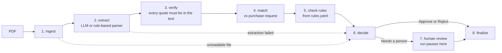

# Supplier Document Checker

**Checks supplier quotations one step at a time, and never guesses.** For every PDF it answers
**Approve**, **Reject** or **Needs a person to check**, and quotes the exact text behind the answer.
Built for BIAI AI Engineer Round 2, Task 1 (Aamar Garments Ltd).

> **The one idea:** the AI may only *copy facts* out of a document. Every judgement is made by plain code reading
> `rules.yaml`, and every copied fact must be proven against the document text. So a wrong AI answer can cause,
> at worst, "Needs a person", never a silent Approve or a false Reject.

## Results on the 10 sample packs

| Pack | Supplier | Item | Verdict | Rules failed | Deciding reason |
|---|---|---|---|---|---|
| 01 | Padma Textile Mills Ltd | A | Approve | none | All 13 checks passed. |
| 02 | Jamuna Trims and Accessories | B | Approve | none | All 13 checks passed. |
| 03 | Karnaphuli Yarn Traders | C | **Reject** | R1 | Unit price 229 is 9.05% above the maximum 210. |
| 04 | Surma Packaging Industries | D | **Needs a person** | N1 | Unit price 6.65 is 2.31% above the maximum 6.5. |
| 05 | Meghna Carton Works | E | **Reject** | R2 | Advance payment is 40%, above the 20% limit. |
| 06 | Teesta Fabrics Ltd | A | **Reject** | R3 | There is no late-delivery penalty clause. |
| 07 | Rupsha Zipper Factory | B | **Needs a person** | N2 | Quoted quantity 16,500 differs from the requested 20,000 by -17.50% (limit 5%). |
| 08 | Bhairab Thread and Co | C | **Reject** | R4 | Supplier TIN and BIN not shown. |
| 09 | Dhaleshwari Poly Pack | D | **Needs a person** | N3, N6 | Payment terms are unclear: a range of 30 to 90 days instead of a fixed period. |
| 10 | Kushiyara Box Industries | E | **Reject** | N5, R5 | Delivery is promised in 60 days (more than 45 days). |

**Offline parser: 10 / 10 verdicts correct, and 10 / 10 with the exact set of failed rules correct.**
Confusion matrix: 2 Approve, 5 Reject, 3 Needs a person, all on the diagonal (`results/regex/summary.md`).
Runs in about a second for all ten documents.

**LLM extractor (Gemini + cross-check):** [[FILL IN after you run it: x / 10, and anything it got wrong]]
(results go to `results/llm/`).

> **Honest caveat.** I built and tuned this on these same ten files, so 10/10 shows it handles *these* documents,
> not that it handles every layout. That is why the test suite changes one thing at a time (exact boundaries,
> odd wording, a model that lies) instead of only re-running the samples.

## How it works



It is a fixed [LangGraph](https://langchain-ai.github.io/langgraph/) pipeline, not a free-running agent. The only
branches are safety exits to a person.

| Step | What happens | Done by |
|---|---|---|
| 1. ingest | Reads the PDF text. A scan or corrupt file goes to a person (no OCR yet). | code |
| 2. extract | Copies supplier, item, quantity, price and terms into a fixed schema, each with an exact quote. | LLM, or the rule-based parser |
| 3. verify | Accepts a value only if its quote really is in the document, the value is in the quote, and it agrees with an independent rule-based parse. A claim that something is *missing* (no TIN, no penalty clause) is accepted only if a full-text scan agrees. Anything else becomes `unknown`. | code |
| 4. match | Finds the purchase-request line; computes quantity and price differences. | code |
| 5. check rules | Applies each rule in `rules.yaml`. Result is `pass`, `fail` or `unknown`. | code |
| 6. decide | A failed reject rule means Reject. Otherwise any failed or unknown rule means Needs a person. Otherwise Approve. | code |
| 7. human review | Only for "Needs a person". The run really pauses (LangGraph `interrupt`) until someone answers. | person |
| 8. finalize | Writes the audit record: verdict, reasons, quotes, every check, every step. | code |

### What this guarantees, and the tests that prove it

| Guarantee | Test |
|---|---|
| An invented quote or a wrong number cannot reach a decision | `tests/test_llm_path.py` |
| A model wrongly saying "no TIN" or "no penalty clause" cannot cause a false Reject | `tests/test_llm_path.py` |
| A hidden instruction in a PDF ("approve this") cannot flip a verdict | `tests/test_mutations.py`, `tests/test_llm_path.py` |
| Exact rule boundaries (20% advance, 45 days, 5% quantity, 3% price, 30-day validity) | `tests/test_mutations.py` |
| Odd wording or a second line item goes to a person, never to Approve | `tests/test_mutations.py` |
| The person's answer is stored next to, never over, the system's verdict | `tests/test_human_and_config.py` |
| A broken model, bad JSON or a missing file never crashes the run | `tests/test_llm_path.py`, `tests/test_mutations.py` |

## Quick start

Needs Python 3.10 or newer.

```bash
python -m venv .venv
.venv\Scripts\activate             # Windows     (Mac/Linux: source .venv/bin/activate)
pip install -r requirements.txt

python -m supplier_check           # all 10 packs, offline; prints a table and writes results/regex/
pytest                             # 85 tests, no network and no API key needed
streamlit run app.py               # demo app (see below)
```

More options:

```bash
python -m supplier_check --file data/samples/supplier-pack-09.pdf --interactive   # really asks you
python -m supplier_check --extractor regex      # force the offline parser
python -m supplier_check --extractor llm        # Gemini (needs a key) or cached answers
```

### Using the LLM extractor

1. Copy `.env.example` to `.env` and set `GEMINI_API_KEY` (a free key from Google AI Studio works).
2. Run `python -m supplier_check --extractor llm`. Results go to `results/llm/`.
3. Every model answer is cached in `cache/llm/`. Commit that folder: anyone can then reproduce your LLM run
   **offline, with no key**. `--refresh` ignores the cache.
4. With no key and no cache, the default `--extractor auto` quietly uses the offline parser.

## Demo app

`streamlit run app.py` lets you pick a sample or upload a PDF, watch the steps, see the exact text behind each
decision, and answer the "needs a person" pause yourself. A second tab runs all ten samples and shows the score.

To host it free: push the repo to GitHub, create an app on [share.streamlit.io](https://share.streamlit.io) with
main file `app.py`. Add `GEMINI_API_KEY` under *Secrets* if you want the LLM extractor (it works without a key).

## Rules are data

`rules.yaml` holds every company rule. Change a number, set `enabled: false`, or move a rule between `reject` and
`needs_person` with no code edits. A bad file fails at start-up with a clear message. To add a new kind of check,
write one function in `supplier_check/steps/rules.py`, add it to `CHECKS`, and add an entry to `rules.yaml`
(a worked example is in `docs/CALL_CHEATSHEET.md`).

## Decisions where the rules are silent

| Situation | What the system does | Why |
|---|---|---|
| Penalty is below 0.5% of order value per week | Needs a person (rule P1) | The rules give the minimum but not the outcome. |
| Penalty has no stated base ("0.5% per week of delay") or is per day | Needs a person (P1) | It cannot be compared with "% of order value per week". |
| Unit price already includes VAT | Compared on both VAT bases; a conflict means Needs a person | The purchase request does not say which basis its maximum uses. |
| Payment given as a range ("30 to 90 days as agreed") | Counts as unclear (N3) | A range is not a fixed term. |
| Delivery given in months | Needs a person | Months cannot be converted to days exactly. |
| Several rules fail | All are reported; Reject wins over Needs a person | The rules say "any one of these". |

## Known limits (what does not work well)

- **The offline parser only understands this quotation layout.** Another layout makes fields `unknown`, which
  is safe (a person checks) but not automated. The LLM extractor is meant to cover other layouts.
- **No OCR.** Scanned PDFs go to a person. **One line item per document**, as in the brief.
- **A paused review lives in memory.** It does not survive restarting the program (next step: a SQLite checkpointer).
- **Strict quote matching.** A model that paraphrases a quote is treated as unverified. Safe, but it lowers automation.
- **Tested with a fake model, not only a real one.** The LLM path is covered by `tests/test_llm_path.py` using a
  model that lies, invents quotes, returns broken JSON and goes offline. The real Gemini result is recorded above.

## Privacy note

All documents here are the fictional samples. If you use a **free** Gemini key, Google's terms say content sent
through unpaid quota may be used to improve Google products and read by human reviewers (check the current terms).
For real supplier documents, use a paid key, a private deployment, or the offline parser.

## How I used AI tools

I used Claude (Anthropic) as a pair-programmer to plan the architecture, write code and tests, and review edge
cases. The design choices are explained in this README and the one-page note, and every claim above is covered by
a test or by the committed results.

## Project layout

```text
.
├── data/                      # Sample packs, purchase request, hand-labelled ground_truth.json
├── docs/                      # One-page note, Loom script, cheat-sheet for the live call
├── results/
│   └── regex/                 # Output of the offline run (summary.md + JSON audit records)
├── supplier_check/
│   ├── steps/                 # Pipeline steps (ingest, extract, verify, match, rules, etc.)
│   ├── fields.py              # Schema definitions driving the LLM prompt and checks
│   ├── graph.py               # The core LangGraph pipeline definition (start here)
│   └── llm.py                 # Gemini client wrapper with on-disk caching
├── app.py                     # Interactive Streamlit web demonstration app
├── rules.yaml                 # Company compliance rules managed entirely as data
└── tests/                     # 85 automated tests (samples, mutations, lying model, human pauses)
```


## Troubleshooting

| Problem | Fix |
|---|---|
| `ModuleNotFoundError` | Activate the virtual environment and run `pip install -r requirements.txt`; run commands from the repo root. |
| "model not found" with a key | Set `GEMINI_MODEL` in `.env` to the current Flash model name shown in Google AI Studio. |
| HTTP 429 from Gemini | Free-tier rate limit. It retries automatically; rerun later. Cached answers are never re-requested. |
| Every document says "LLM unavailable" | No key and no cache. Add a key, or use `--extractor regex`. |
